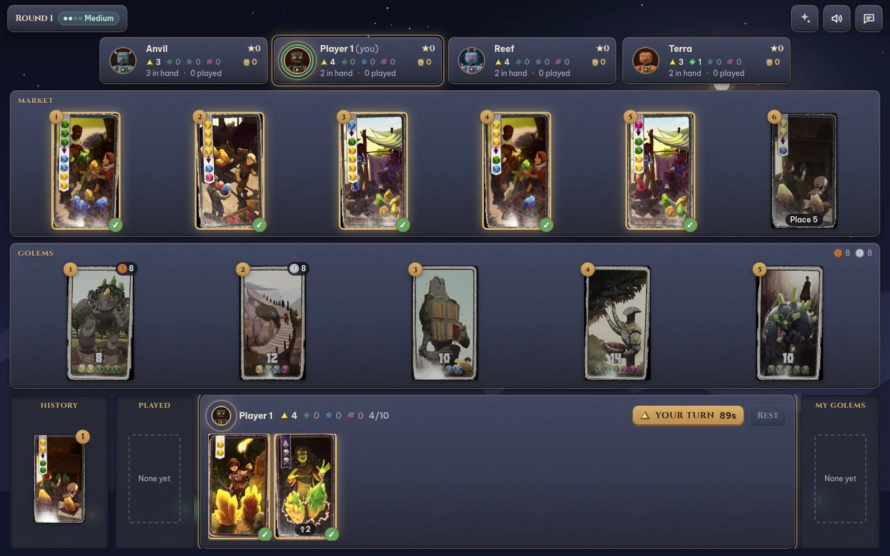
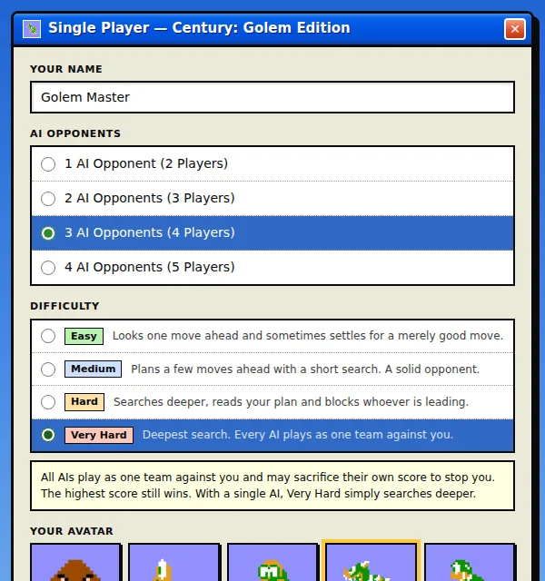
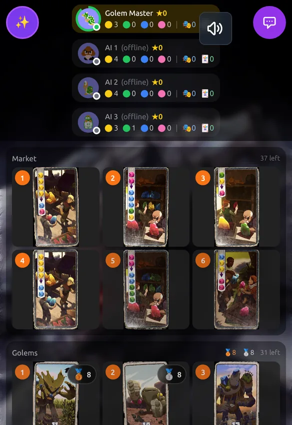
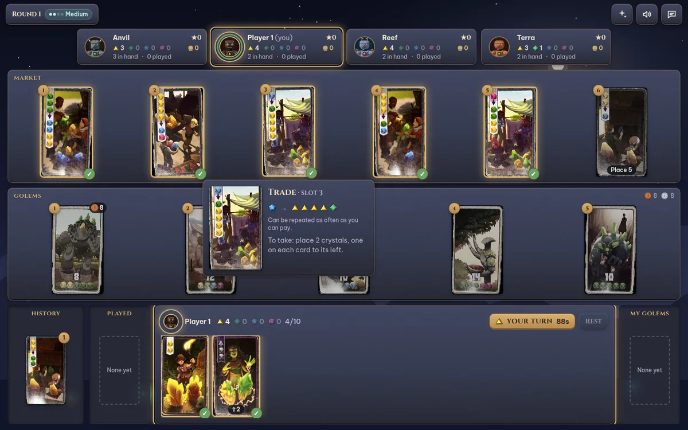
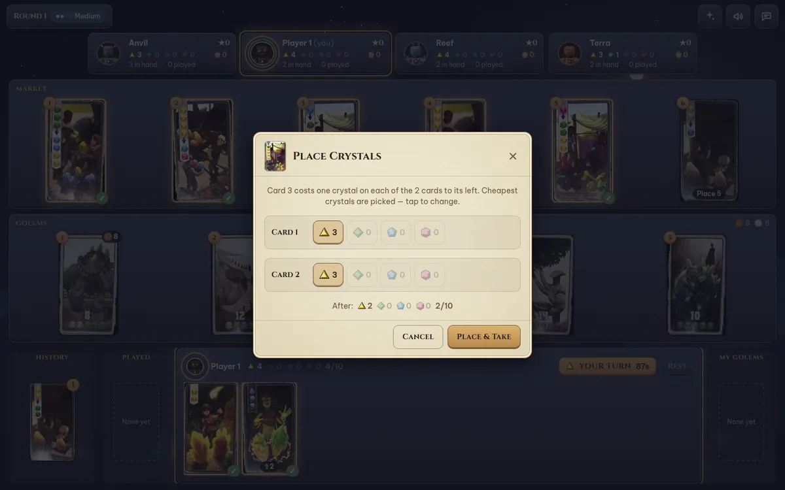
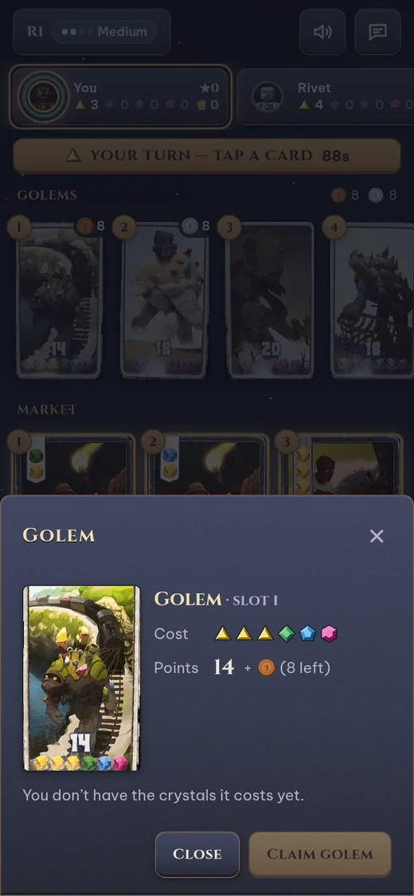
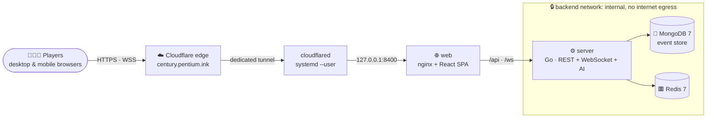

<div align="center">



<h3>💎 A self-hosted, real-time multiplayer crystal-trading card game</h3>

<p>
An unofficial web take on the <b>Century: Golem Edition</b> board game.<br/>
Play solo against 1–4 AI opponents or with up to 5 friends, right in the browser, on desktop or phone.
</p>

<p>
<a href="https://century.pentium.ink"></a>
</p>

<p>


</p>

<p>


</p>

<p><a href="#-features">Features</a> • <a href="#-screenshots">Screenshots</a> • <a href="#-how-to-play">How to play</a> • <a href="#-quick-start">Quick start</a> • <a href="#-architecture">Architecture</a> • <a href="#-configuration">Configuration</a> • <a href="#-operations">Operations</a> • <a href="#-credits--disclaimer">Credits</a></p>



</div>


## ✨ Features

<table>
<tr>
<td width="50%" valign="top">

#### 🎮 Gameplay
- **Solo vs AI** with **4 difficulty levels** (Easy → Very Hard): Monte-Carlo tree search that reads your plan,
  blocks the leader and, at Very Hard, makes you its main rival when you are as dangerous as the leading AI — see
  [AI overview](docs/ai/README.md)
- **Online multiplayer** for 2–5 players: create a room (optional custom ID) or join one from the open-room list
- **Spectate** rooms that are already in progress
- **Turn timer** (60 s by default); when it runs out, an AI plays the turn for you
- **Official rules engine**: market deposits (any colour, they stay on the cards), crystal upgrades, multi-trades, the 10-crystal limit, copper and silver coin bonuses, 6/5-golem end, later-seat tie-break

</td>
<td width="50%" valign="top">

#### 🌐 Experience
- **Real-time** state sync over WebSocket, with ping/pong disconnect detection
- **Reconnect** to your seat after a dropped connection (30-day client cookie)
- **One "Stone & Crystal" look** on every screen: carved-stone panels, parchment popups, bronze buttons, a night-mountain backdrop
- **Colour-blind friendly crystals**: each colour has its own shape (▲ yellow, ◆ green, ⬟ blue, ⬢ pink)
- **Helpful board**: cards you can take or claim glow, hovering (or tapping on a phone) shows what a card does, popups pick the cheapest crystals for you and warn before you go over 10
- **Phone-first mobile layout** (portrait and landscape): big touch targets, tap a card to see it and act, safe areas for notches
- **24 original golem avatars** drawn for this project; AI opponents wear random ones and are named after them (Basalt, Mossback, Rime…)
- **Your own picture as avatar** in both modes: pick an image (≤ 5 MB), drag/zoom it into the circle; it is shrunk to 256 px in the browser, re-encoded on the server (metadata removed) and **deleted with the room** — never stored
- **Undo** an overflowing card play from the discard popup; **reconnect banner** keeps the board on screen if the connection drops
- **Sound effects** for your turn, plays, purchases, golem claims, rests, the last round and game over

</td>
</tr>
<tr>
<td width="50%" valign="top">

#### 🐳 Self-hosting
- **One-command deploy** with `docker compose up -d --build`
- **Multi-arch**: builds natively on `amd64` and `arm64` (production runs on a phone 📱)
- **HTTPS without open ports** through a dedicated Cloudflare Tunnel
- **Game history** kept as events and snapshots in MongoDB
- **Self-cleaning**: idle rooms are removed automatically, and a room cap blocks spam

</td>
<td width="50%" valign="top">

#### 🔒 Privacy by design
- No analytics, CDNs or third-party fonts: the two open-source fonts and every asset are served by our own nginx
- Backend sits on an **internal Docker network with no internet egress**
- Third-party integrations (Telegram, Firebase, Google OAuth) are removed or disabled
- `privacy-audit.sh` checks for regressions on every change

</td>
</tr>
</table>

## 📸 Screenshots

<table>
<tr>
<td align="center" width="50%"><br/><sub><b>Main menu</b>: Single Player or Multiplayer</sub></td>
<td align="center" width="25%"><br/><sub><b>Lobby</b>: 1–4 AIs, Easy → Very Hard, pick a golem</sub></td>
<td align="center" width="25%"><br/><sub><b>Mobile</b>: the whole board on a phone</sub></td>
</tr>
<tr>
<td align="center"><br/><sub><b>Card details</b> on hover (desktop)</sub></td>
<td align="center"><br/><sub><b>Buying</b>: cheapest crystals pre-picked</sub></td>
<td align="center"><br/><sub><b>Tap a card</b> to see it and act</sub></td>
</tr>
</table>

## 🎲 How to play

> **Goal:** have the most **victory points** when the game ends. Points come from golems, coins and leftover crystals.

**Crystals** go up in value: ▲ **Yellow** → ◆ **Green** → ⬟ **Blue** → ⬢ **Pink** (in the game each colour also has its own shape). You can hold at most **10**, and any excess must be discarded — the popup picks the cheapest for you, and an overflowing card play can be undone.

**Setup.** Everyone starts with two merchant cards (*produce 2 yellow* and *upgrade ×2*) and crystals based on seat order:

| Seat | 1st | 2nd | 3rd | 4th | 5th |
|:--|:--:|:--:|:--:|:--:|:--:|
| Crystals | 🟡×3 | 🟡×4 | 🟡×4 | 🟡×3 🟢×1 | 🟡×3 🟢×1 |

**On your turn, take exactly one action:**

| Action | What happens |
|:--|:--|
| 🃏 **Play** a merchant card | **Produce** crystals, **upgrade** crystals one level per step (the card shows ⇧2 / ⇧3 steps; tap a crystal to raise it) or **trade** one set for another, as many times as you can afford |
| 🛒 **Acquire** a merchant card | The leftmost card in the market is free. For any other card, leave 1 crystal on each card to its left, and take any crystals already sitting on the card you pick |
| 🗿 **Claim** a golem | Pay the crystals shown on it. The 1st slot also pays a **copper coin (+3)** and the 2nd a **silver coin (+1)**, while they last |
| 💤 **Rest** | Return all your played merchant cards to your hand |

**Game end.** When someone claims their **6th golem** (2–3 players) or **5th golem** (4–5 players), the current round
is played out and the game ends. Final score = golem points + coins + **1 point per non-yellow crystal**; ties go to the
player **later in turn order**. In single player your seat (and so the starting player) is drawn at random.

## 🚀 Quick start

**Requirements:** Docker Engine with the Compose v2 and Buildx plugins, on Linux `amd64` or `arm64`.

```bash
git clone git@github.com:nghiaump/century-golem.git
cd century-golem/deploy
DOCKER_BUILDKIT=1 docker compose up -d --build   # first build takes a few minutes
./smoke-test.sh http://127.0.0.1:8400             # expect: ALL PASS
```

Open **http://127.0.0.1:8400**, choose *Single Player* and play. 🎉

> [!TIP]
> To put it on the internet without opening ports, point a Cloudflare Tunnel at `http://127.0.0.1:8400`.
> See [runbook §7](docs/runbook.md#7-tunnel-cloudflare) and [§11](docs/runbook.md#11-máy-chạy-đồng-bộ-code-rollback-chuyển-sang-pixel3xl-ngày-2026-11-14) for how the production host is wired.

## 🏰 Architecture



- **Live game state stays in the Go server's memory**, so it's fast. MongoDB stores every action as an event, plus snapshots, for history.
- The frontend calls the API and WebSocket on the **same origin**: no CORS and no hard-coded hosts in the bundle.
- Only `web` publishes a port, bound to `127.0.0.1:8400`. MongoDB, Redis and the game server have no route to the internet.

> [!NOTE]
> 📱 **Fun fact:** production runs on a **Pixel 3 XL** phone (Snapdragon 845, Ubuntu 24.04 `arm64`).
> The whole stack idles at about **255 MB of RAM**.

## 🔧 Configuration

Server settings are environment variables. Set them in [`deploy/docker-compose.yml`](deploy/docker-compose.yml); anything not set there uses its default.

| Variable | Default | Description |
|:--|:--:|:--|
| `SESSION_IDLE_WAITING_SECONDS` | `300` | Remove a not-yet-started room after this long with no open connection |
| `SESSION_IDLE_PLAYING_SECONDS` | `600` | Keep an abandoned game this long so players can reconnect |
| `SESSION_IDLE_ENDED_SECONDS` | `120` | Remove finished games |
| `MAX_SESSIONS` | `100` | Room cap in memory; beyond it `/api/create` and `/api/single` return `503` |
| `DEFAULT_TURN_TIMEOUT_SECONDS` | `60` | Turn timer before the AI plays for an idle player |
| `WEBSOCKET_PING_INTERVAL` | `15` | Seconds between WebSocket pings |
| `LOG_LEVEL` / `LOG_FORMAT` | `info` / `json` | Server logging |
| `AI_MAX_THREADS` | `0` (auto) | Server-wide cap on AI search threads (`4` on the phone) |
| `AI_THINK_SCALE_PCT` | `100` | Multiplies every AI think budget (Very Hard 3 s, Hard 1.4 s, Medium 0.3 s) |
| `AI_MIN_DELAY_MS` | `800` | Minimum visible "thinking" time per AI move |
| `AI_MAX_NODES` | `200000` | Node cap per search tree (memory bound) |
| `AI_PAUSE_WHEN_EMPTY` | `1` | AI turns pause while nobody is connected to the room |
| `AI_INTENT_MESSAGES` | `0` | Show "AI intent" toasts ("… took the golem you were going for"); off by default |
| `TELEGRAM_*` `FIREBASE_*` `GOOGLE_OAUTH_*` | *(empty)* | **Must stay empty**: these integrations are deliberately disabled |

## 🧰 Operations

```bash
cd deploy
docker compose ps                                                  # health of all 4 services
curl -s http://127.0.0.1:8400/api/list                             # open multiplayer rooms
DOCKER_BUILDKIT=1 docker compose up -d --build --no-deps web       # redeploy frontend (safe)
DOCKER_BUILDKIT=1 docker compose up -d --build --no-deps server    # redeploy backend (⚠ ends live games)
./smoke-test.sh && ./privacy-audit.sh                              # run after every change
```

> [!IMPORTANT]
> Games in progress live only in the server's memory. Restarting or rebuilding `server` ends all of them, so check `/api/list` first.

| Script | What it does |
|:--|:--|
| [`smoke-test.sh`](deploy/smoke-test.sh) `[URL]` | End-to-end check: pages, assets, API, creates an AI game, WebSocket handshake |
| [`privacy-audit.sh`](deploy/privacy-audit.sh) | Checks for trackers or foreign hosts in the bundle, secrets in the source, and confirms the backend has no internet |
| [`regen-patches.sh`](deploy/regen-patches.sh) | Regenerates patches `0002`/`0003` from `src/golem` and proves the tree can be rebuilt from the original download |
| [`sanitize-src.sh`](deploy/sanitize-src.sh) | Cleans a new upstream drop: strips foreign config, applies patches, copies the golem avatars and fonts, removes image metadata |
| [`make-golem-avatars.py`](deploy/make-golem-avatars.py) | Draws the 24 original golem avatars as SVG (12 golems + one variant each); `--preview` writes a contact sheet |
| [`ui-shots.mjs`](deploy/ui-shots.mjs) `[URL] [DIR]` | Screenshots every screen at desktop, phone and landscape sizes and fails on external requests, console errors, overflow, text < 12 px or touch targets < 44 px |
| [`ship.sh`](deploy/ship.sh) `web\|server\|all` | Production deploy: builds on a workstation, the phone only packages and restarts |
| [`strip-image-metadata.py`](deploy/strip-image-metadata.py) | Removes EXIF/XMP metadata from images |

📖 Full operations guide (backup and restore, tunnel, troubleshooting, rollback): [`docs/runbook.md`](docs/runbook.md). The docs are written in Vietnamese.

## 📂 Project structure

```text
.
├── deploy/                    # everything we own: compose, Dockerfiles, nginx, scripts, patches
│   ├── docker-compose.yml     # mongodb · redis · server (internal network) · web (127.0.0.1:8400)
│   ├── Dockerfile.server      # Go build for the host's architecture (amd64 / arm64)
│   ├── Dockerfile.web         # Vite build → nginx
│   ├── nginx.conf             # SPA + /api, /ws reverse proxy, asset caching
│   └── patches/               # 0001 auth-off · 0002 frontend (UI, index.html, Tailwind) · 0003 backend (rules, AI, rooms)
├── src/golem/                 # upstream game, sanitized + patched
│   ├── cmd/server/            # Go entry point
│   ├── internal/              # game engine & AI, session, server, event store
│   └── web/react-frontend/src # React UI: components/ui (design system), board/, start/, mobile/, desktop/
├── assets-src/                # binary sources copied in by sanitize: avatars/ (golem SVGs), fonts/ (OFL woff2)
└── docs/                      # architecture, runbook, privacy, upstream changes, README assets
```

## 🔌 API

<details>
<summary>REST & WebSocket endpoints</summary>

<br/>

| Method | Path | Notes |
|:--|:--|:--|
| `GET` | `/health` | Liveness: `OK` |
| `GET` | `/api/list` | Open multiplayer rooms (single-player games are hidden) |
| `POST` | `/api/create` | `{numPlayers, sessionID?, creatorName}`: new multiplayer room |
| `POST` | `/api/single` | `{numAI: 1..4, difficulty?: "easy"\|"medium"\|"hard"\|"veryhard", turnTimeout?}` → `{sessionID: "single_…", difficulty, aiLevels}` |
| `POST` | `/api/join` | Join a room |
| `POST` | `/api/avatars` | Body: a JPEG/PNG (≤ 1 MB, the browser already shrank it) → `{avatar: "u_<16 hex>"}`; kept in memory only while a room uses it |
| `GET` | `/api/avatars/<id>.jpg` | A player's own picture (256 px JPEG, `Cache-Control: private`); `404` once its room is gone |
| `POST` | `/api/sessions/start` | `{sessionID}`: start the game |
| `WS` | `/ws?session=&name=&avatar=[&spectate=true][&clientID=]` | Game channel (`state`, `playerAssigned`, …) |
| `GET` | `/api/games` · `/api/events?gameId=` · `/api/snapshot?gameId=` | Game history |

</details>

## 🐞 Known issues

- An upstream race can crash the server with *send on closed channel* when a player disconnects mid-broadcast. Docker restarts it automatically, but games in progress are lost.
- The `session` package has data races reported by `go test -race`.
- History endpoints (`/api/games`, `/api/events`, …) are public and unauthenticated, and client IDs are guessable
  (deck order of games still being played is hidden).
- The mobile layout is tested in Chrome's phone emulation; iPhone Safari (dynamic viewport, notch safe areas) has not been checked on a device.

## 🙏 Credits & disclaimer

- ***Century: Golem Edition*** is a board game designed by **Emerson Matsuuchi** and published by **Plan B Games**.
  This repository is an **unofficial, non-commercial fan project** for private play. It is not affiliated with or endorsed by Plan B Games.
  Game names and card artwork belong to their respective owners.
- The **user interface, the golem avatars and the backdrop are original** to this project; avatars are drawn by
  [`make-golem-avatars.py`](deploy/make-golem-avatars.py).
- Fonts: **Cinzel** (© The Cinzel Project Authors) and **Be Vietnam Pro** (© The Be Vietnam Pro Project Authors), both
  under the SIL Open Font License 1.1 — licences in [`assets-src/fonts/`](assets-src/fonts/).
- The game engine is based on a third-party implementation, sanitized and extended for self-hosting.
  Every change is documented in [`docs/upstream-changes.md`](docs/upstream-changes.md).
- **No license is granted.** This is a private repository.


<div align="center">
<sub>Built with 💎 crystals, ☕ coffee and one stubborn old phone · <a href="https://century.pentium.ink">century.pentium.ink</a> · <a href="#top">⬆ back to top</a></sub>
</div>
